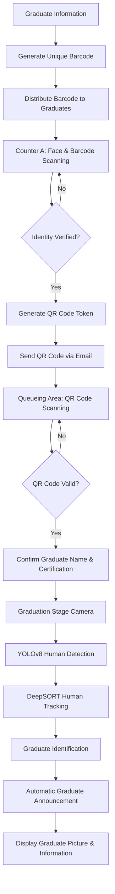

# 🎓 FaceCert — Intelligent Face Recognition & Barcode Detection for Graduation Ceremony

**BMDS2133 — Image Processing Assignment**

FaceCert is an intelligent graduation ceremony management system that integrates **Face Recognition, Barcode/QR Code Processing, and Human Tracking** to automate graduate identification, attendance verification, and stage announcement.

The system aims to improve the efficiency and accuracy of graduation ceremony operations by reducing manual verification and automating the process of identifying graduates as they walk across the stage.

---

## 🎯 Project Objectives

- Automate graduate identity verification using face recognition.
- Generate unique barcodes for graduate identification.
- Implement QR code-based verification for stage queue management.
- Track graduates as they move across the graduation stage.
- Automatically identify and announce the next graduate during the ceremony.
- Display the graduate's picture and relevant information on the hall screen.

---

## 🛠️ Models, Algorithms & Technologies

| Model / Library | Application | Description |
|---|---|---|
| **InsightFace** | Face Recognition | Identify graduates using facial features. |
| **MTCNN + FaceNet** | Face Recognition | Detect faces and generate facial embeddings for identity matching. |
| **Pyzbar** | Barcode Processing | Read and decode barcodes for graduate identification. |
| **ZXing-C++** | QR Code Processing | Process QR codes used for graduate verification. |
| **DeepSORT** | Human Tracking | Track individuals across video frames. |
| **YOLOv8** | Human Detection & Tracking | Detect people and support tracking throughout the graduation stage. |

---

## ⚙️ System Workflow

The FaceCert system consists of four main stages:

### 1. 🎫 Barcode Generation & Distribution

- Generate a unique barcode for each graduate before the graduation ceremony.
- Distribute the generated barcode to graduates in advance.
- Use the barcode as an initial identification credential during attendance verification.

### 2. 📸 Attendance Verification — Counter A

Graduates are required to complete identity verification at Counter A.

**Process:**
1. Graduate scans their face using the camera.
2. Graduate presents their assigned barcode for scanning.
3. The system verifies the graduate's facial identity and barcode information.
4. Upon successful verification, a unique QR code (token) is generated.
5. The QR code is sent to the graduate's registered email address.

### 3. 📱 Graduate Verification — Queueing Area

Before entering the graduation stage, graduates must scan their QR code at the stairs.

**Process:**
1. Graduate presents the QR code received through email.
2. The system scans and validates the QR code.
3. The system retrieves the graduate's information.
4. The graduate's name and certification details are confirmed.

### 4. 🎥 Automatic Stage Recognition & Announcement

A camera is installed at the center of the graduation hall to monitor the stage.

**Process:**
1. The camera captures the entire graduation stage.
2. YOLOv8 and DeepSORT are used to detect and track graduates as they move across the stage.
3. The system identifies the graduate based on the tracking and recognition process.
4. When a graduate walks from one side of the stage to the other, the system automatically triggers the next graduate announcement.
5. The graduate's picture and relevant information are displayed on the hall screen.

---

## 🔄 Overall System Architecture

---

## ✨ Key Features

- **Face Recognition:** Verify graduate identities through facial recognition.
- **Barcode Identification:** Generate unique barcodes for graduate identification.
- **QR Code Verification:** Provide QR-based verification at the graduation queue.
- **Real-Time Human Tracking:** Monitor graduate movements across the stage.
- **Automated Announcements:** Automatically trigger graduate announcements.
- **Visual Information Display:** Display graduate pictures and information on the graduation hall screen.
